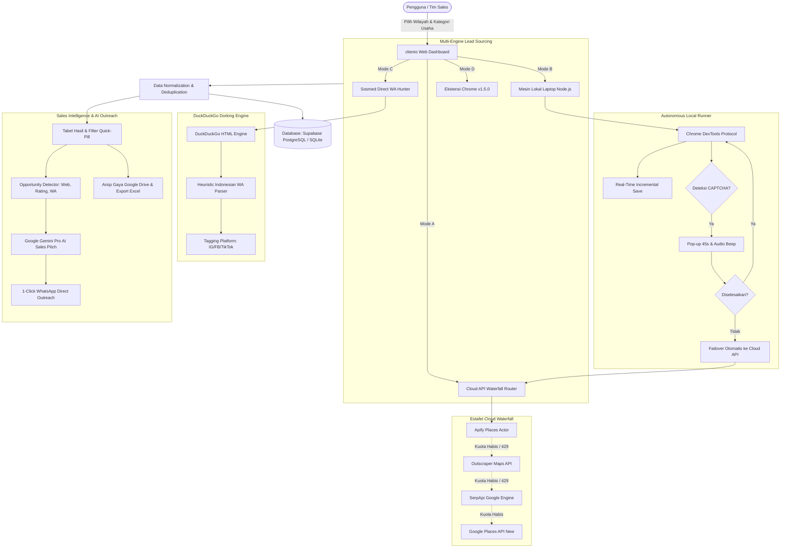
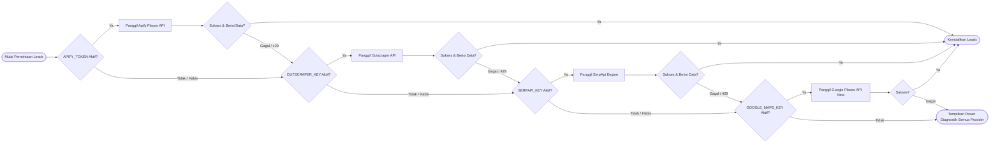
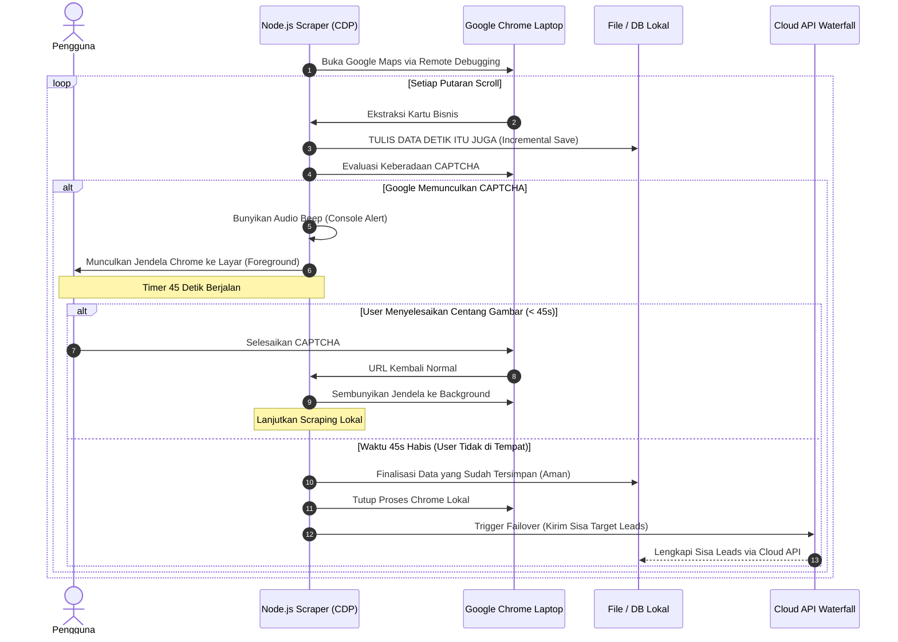

# cliento — Autonomous AI Sales Intelligence & Multi-Channel Lead Engine

<p align="center">
  
  
  
  
  
  
</p>

<p align="center">
  <strong>cliento</strong> adalah platform <em>sales intelligence</em> dan otomasi prospeksi bisnis B2B modern yang menggabungkan <strong>Multi-Engine Google Maps Scraping</strong>, <strong>Social Media Direct WhatsApp Hunter</strong>, serta <strong>Google Gemini AI Sales Pitch Generator</strong> dalam satu ekosistem terpadu.
</p>

---

## 📌 Daftar Isi
1. [Latar Belakang & Nilai Tambah (Keunggulan Kompetitif)](#-latar-belakang--nilai-tambah-apa-yang-beda-dari-yang-lain)
2. [Arsitektur Sistem & Diagram Alur (Flowcharts)](#-arsitektur-sistem--diagram-alur)
   - [2.1 High-Level Architecture Flowchart](#21-high-level-architecture-flowchart)
   - [2.2 Multi-Engine Waterfall & Failover Decision Tree](#22-multi-engine-waterfall--failover-decision-tree)
   - [2.3 Algoritma Interactive CAPTCHA & Auto-Save 45s](#23-algoritma-interactive-captcha--auto-save-45s)
3. [Fitur Utama & Modul Program](#-fitur-utama--modul-program)
4. [Diagram Menu & Sitemap Navigasi](#-diagram-menu--sitemap-navigasi-aplikasi)
5. [Spesifikasi Algoritma & Logika Teknis](#-spesifikasi-algoritma--logika-teknis)
6. [Tabel Perbandingan Komparatif](#-tabel-perbandingan-komparatif)
7. [Panduan Instalasi & Konfigurasi](#-panduan-instalasi--konfigurasi)
8. [Struktur Repositori](#-struktur-repositori)
9. [Uji Kualitas & Test Suites](#-uji-kualitas--test-suites)
10. [Lisensi & Portofolio Pengembang](#-lisensi--portofolio-pengembang)

---

## 💡 Latar Belakang & Nilai Tambah (Apa yang Beda dari yang Lain?)

Sebagian besar tools scraping prospek bisnis di pasar memiliki kelemahan mendasar:
1. **Ekstensi Browser Biasa:** Rentan macet saat *scrolling*, memboroskan waktu, dan jika browser *crash* atau terkena CAPTCHA, semua data yang sudah di-scroll hilang seketika (*zero tolerance*).
2. **Layanan Cloud API Berbayar:** Sangat mahal, dan batas kuota gratis bulanan (misal 100–500 data) langsung habis dalam 1–2 kali pencarian.
3. **Data Tidak Siap Pakai:** Hanya menghasilkan CSV mentah tanpa verifikasi kontak nomor seluler vs telepon kantor, tanpa pemetaan wilayah, dan tanpa pesan penawaran (*cold outreach*).

### 🚀 Mengapa cliento Berbeda?
* **Multi-Engine Waterfall (Estafet Berurutan):** Menggabungkan jatah gratis bulanan dari **Apify (\$5 $\approx$ 1.500 tempat)**, **Outscraper (500 data)**, **SerpApi (100 search)**, dan **Google Places API (5.000 req)** secara berantai. Kuota gratis menjadi kumulatif ($\sim\mathbf{2.100+}$ data prospek gratis per bulan) tanpa memboroskan kuota untuk data duplikat.
* **Autonomous Local Engine dengan Real-Time Incremental Save:** Mesin Node.js lokal berbasis Chrome DevTools Protocol (CDP) yang **menyimpan data detik itu juga setiap kali 1 tempat terdeteksi**. Jika terjadi pemutusan atau CAPTCHA, data tidak pernah hilang!
* **Hybrid CAPTCHA Resolver (45s Fail-safe):** Mengeluarkan audio alert (*beep*), memunculkan jendela browser interaktif ke layar selama 45 detik, lalu otomatis melakukan *failover* ke Cloud API jika pengguna sedang tidak di tempat.
* **Social Media Direct WA Hunter (DuckDuckGo Dorking Engine):** Tidak hanya mengandalkan Google Maps; sistem memburu nomor WhatsApp langsung dari bio/postingan Instagram, Facebook, TikTok, dan Linktree tanpa butuh API key atau VPN.
* **AI-Powered Outreach Generator:** Terintegrasi langsung dengan **Google Gemini Pro** untuk menganalisis kelemahan bisnis target (misal: rating rendah butuh jasa review, tidak punya website butuh web development) dan menyusun draft pesan WhatsApp yang dipersonalisasi dalam 1 klik.
* **Google Drive-Style Nested Archives & Excel Exporter:** Manajemen arsip multi-folder dengan penyimpanan multi-sheet Excel yang mempertahankan atribusi sumber dan validasi metrik.

---

## 📊 Arsitektur Sistem & Diagram Alur

### 2.1 High-Level Architecture Flowchart



---

### 2.2 Multi-Engine Waterfall & Failover Decision Tree



---

### 2.3 Algoritma Interactive CAPTCHA & Auto-Save 45s



---

## 📦 Fitur Utama & Modul Program

### 1. Multi-Engine Lead Sourcing
* **Cloud API Waterfall Router (`api/cloud_scraper.php`):** Orkestrator estafet multi-cloud yang memastikan permintaan diarahkan ke akun gratis yang masih memiliki kuota aktif.
* **Autonomous Local Engine (`scripts/local_headless_scraper.js`):** Script mandiri berbasis Node.js yang mengendalikan Google Chrome melalui port DevTools biner (CDP).
* **Social Media Direct WA Hunter (`api/dorking_hunter.php`):** Mesin pencari kontak aktif dari Instagram, Facebook, TikTok, dan Linktree berbasis DuckDuckGo dengan *human-like polite throttling* (1,5 detik).
* **Ekstensi Chrome v1.5.0 (`extension/`):** Ekstensi berbasis Manifest V3 dengan *single-click workflow* dan ekspor JSON bersih.

### 2. Wilayah Administratif & Peta Interaktif
* **Peta Interaktif Leaflet:** Menampilkan poligon batas administratif (Provinsi $\rightarrow$ Kabupaten/Kota $\rightarrow$ Kecamatan $\rightarrow$ Kelurahan/Desa) atau radius titik koordinat (KM slider).
* **Dataset Terpadu Indonesia:** Database wilayah terlengkap yang memetakan puluhan ribu kecamatan dan kelurahan di seluruh Indonesia.

### 3. Sales Intelligence & Opportunity Detector
* **Rating Profiling:** Mengelompokkan bisnis ke dalam:
  * *Low Rating (< 4.2):* Peluang penawaran jasa manajemen reputasi, review booster, atau perbaikan layanan.
  * *High Rating ($\ge$ 4.5):* Peluang penawaran solusi enterprise dan kemitraan skala besar.
* **Website Gap:** Mendeteksi bisnis yang belum memiliki website resmi untuk penawaran jasa pembuatan website & SEO.
* **AI Sales Pitch Generator (Gemini Pro):** Menghasilkan argumen penjualan yang tajam berdasarkan kategori usaha, nama pemilik/brand, dan ulasan pelanggan.

### 4. Enterprise Data Explorer & Arsip
* **Pemisahan Sumber (Source Provenance):** Data dari Google Maps dan data dari Sosmed Dorking dipisahkan secara tegas dengan filter satu klik.
* **Penyimpanan Multi-Folder (Gaya Google Drive):** Pengelolaan arsip bertingkat untuk mengelompokkan prospek per wilayah atau per kampanye.
* **Excel Multi-Sheet Exporter:** Ekspor data rapi dengan lembar ringkasan (*Overview*) dan rincian kontak.

---

## 🗺️ Diagram Menu & Sitemap Navigasi Aplikasi

```
cliento (Sales Intelligence)
├── 🏢 Panel Utama (index.html)
│   ├── 🧭 Sidebar & Navigasi
│   │   ├── Beranda / Dashboard Ringkasan
│   │   ├── Prospek Bisnis (Scraper Orchestrator)
│   │   ├── Master Database Wilayah
│   │   ├── Arsip Data & Folder Explorer (Google Drive Style)
│   │   └── Pengaturan Template WhatsApp
│   │
│   ├── 📍 Setup Parameter Wilayah & Kategori
│   │   ├── Mode Wilayah Administratif (Batas Garis Merah)
│   │   └── Mode Titik Peta & Radius KM (Slider)
│   │
│   ├── ⚡ Mode Eksekusi Pengambilan Data
│   │   ├── Mode A: Pencarian Tertarget (Buka Google Maps)
│   │   ├── Mode B: Seluruh Kabupaten/Kota (Sapu Bersih)
│   │   ├── Mode C (Otomatis): Cloud API Waterfall (Apify ➔ Outscraper ➔ SerpApi)
│   │   ├── Mode C (Otomatis): Mesin Lokal Laptop (Auto-save + Popup 45s)
│   │   └── Mode C (Otomatis): Sosmed WA Hunter (Instagram, FB, TikTok Dorking)
│   │
│   ├── 📋 Tabel Hasil Ekstraksi Prospek
│   │   ├── Filter Quick-Pill: Semua Leads
│   │   ├── Filter Quick-Pill: Punya WhatsApp
│   │   ├── Filter Quick-Pill: Sumber Google Maps
│   │   ├── Filter Quick-Pill: Sumber Sosmed Dorking
│   │   ├── Filter Quick-Pill: Rating Rendah / Mapan / Tanpa Web
│   │   ├── Modal AI Sales Pitch (Google Gemini Pro)
│   │   ├── Tombol Chat WhatsApp 1-Klik
│   │   ├── Simpan ke Arsip Folder
│   │   └── Download Excel (.xlsx)
│   │
│   └── 📂 Modal Arsip & Riwayat Scraping
│       ├── Pohon Folder Bertingkat
│       └── Riwayat Sesi Pengambilan Data
│
└── ⚙️ Panel Administrasi (admin.html)
    ├── Manajemen Akun Pengguna & Role (Admin / Customer)
    ├── Pengaturan API Keys (Gemini, Apify, Outscraper, SerpApi, Places)
    └── Log & Metrik Sistem
```

---

## ⚙️ Spesifikasi Algoritma & Logika Teknis

### 1. Algoritma Waterfall Failover
```text
Algoritma: CloudScrapeWaterfall(Query, Limit, PreferredProvider)
Input     : Query pencarian (teks), Limit (integer), PreferredProvider (string opsional)
Output    : Objek JSON berisi daftar tempat terstruktur dan nama provider yang berhasil

1. Inisialisasi Chain = ['apify', 'outscraper', 'serpapi', 'google_places']
2. JIKA PreferredProvider ADA MAKA:
      Pindahkan PreferredProvider ke urutan pertama di Chain
3. UNTUK SETIAP Provider DI DALAM Chain:
      a. JIKA Provider TIDAK MEMILIKI Kunci API Terkonfigurasi MAKA:
            Lanjutkan ke Provider berikutnya (SKIP)
      b. Jalankan pemanggilan HTTP cURL ke endpoint Provider dengan Timeout ketat
      c. JIKA Respons HTTP == 200 DAN Jumlah Tempat >= 1 MAKA:
            Normalisasi data ke format baku cliento
            KEMBALIKAN { success: true, provider: Provider, places: DataPlaces }
      d. JIKA Respons HTTP == 429 ATAU 401 ATAU Timeout MAKA:
            Catat error pada Log Diagnostik
            Lanjutkan ke Provider berikutnya secara otomatis
4. JIKA semua Provider gagal atau tidak ada API Key:
      KEMBALIKAN { success: false, message: "Semua provider gagal", details: LogDiagnostik }
```

### 2. Heuristik Normalisasi Nomor WhatsApp Indonesia
Format nomor telepon di Indonesia sangat beragam (`+62812...`, `62812...`, `0812...`, `0812-3456-7890`). Modul `normalizeIndonesianPhone()` melakukan pembersihan dengan aturan:
$$\text{CleanDigits} = \text{RegexReplace}(\text{RawPhone}, \ `[^\d+]`, \ `''`)$$
$$\text{Phone} = \begin{cases} 
\text{"0"} + \text{Substring}(\text{CleanDigits}, 3) & \text{jika diawali "+62"} \\
\text{"0"} + \text{Substring}(\text{CleanDigits}, 2) & \text{jika diawali "62" dan panjang} > 8 \\
\text{CleanDigits} & \text{jika diawali "08"}
\end{cases}$$
Nomor divalidasi memiliki panjang antara 10 hingga 14 digit untuk memastikan nomor tersebut adalah nomor seluler aktif yang mendukung WhatsApp.

---

## 🥊 Tabel Perbandingan Komparatif

| Fitur / Parameter | Ekstensi Chrome Biasa | Layanan SaaS Berbayar (Outscraper/dll) | cliento (Sales Intelligence) |
| :--- | :---: | :---: | :---: |
| **Biaya Pemakaian** | Gratis (manual) | Berbayar per record mahal | **100% Gratis & Mandiri** |
| **Kapasitas Kuota Gratis** | Terbatas tenaga manual | 100–500 record/bulan | **~2.100+ record/bulan (Kumulatif)** |
| **Keamanan Data saat Gangguan** | ❌ Hilang semua jika crash | ✔️ Tersimpan di cloud | **✔️ Real-Time Incremental Save** |
| **Penanganan CAPTCHA** | ❌ Script macet selamanya | Menggunakan proxy mahal | **✔️ Pop-up Interaktif 45s + Audio Alert** |
| **Sumber Data** | Hanya Google Maps | Hanya Google Maps | **Google Maps + Sosmed WA Hunter** |
| **Buru Kontak Media Sosial** | ❌ Tidak ada | ❌ Tambahan biaya tinggi | **✔️ Bawaan (IG, FB, TikTok, Linktree)** |
| **Sales Intelligence AI** | ❌ Tidak ada | ❌ Tidak ada | **✔️ Google Gemini Pro AI Pitch** |
| **Manajemen Arsip Folder** | ❌ File CSV tercecer | Database flat standar | **✔️ Arsip Bertingkat Gaya Google Drive** |

---

## 🛠️ Panduan Instalasi & Konfigurasi

### Persyaratan Sistem:
* Web Server: **Apache (XAMPP)** atau Nginx.
* PHP: **Versi 7.4 atau lebih baru** (ekstensi `pdo_pgsql`, `pdo_sqlite`, `curl`, `json` aktif).
* Node.js: **Versi 22+ atau 24+** (untuk menjalankan mesin lokal CDP).
* Browser: **Google Chrome** atau Microsoft Edge terpasang di sistem operasi Windows.

### Langkah Pemasangan:

1. **Clone Repositori:**
   ```bash
   git clone https://github.com/recreativeid/cliento.git
   cd cliento
   ```

2. **Konfigurasi Kredensial Lokal:**
   Salin file konfigurasi contoh:
   ```bash
   cp config.local.example.php config.local.php
   ```
   Buka `config.local.php` dan sesuaikan kebutuhan Anda:
   ```php
   return [
       // Database Supabase Cloud (Opsional jika ingin multi-user cloud)
       'SUPABASE_DB_HOST'     => 'aws-0-ap-southeast-1.pooler.supabase.com',
       'SUPABASE_DB_USER'     => 'postgres.YOUR_PROJECT',
       'SUPABASE_DB_PASSWORD' => 'PASSWORD_ANDA',

       // API Keys AI & Cloud Scraper (Dapatkan gratis via email)
       'GEMINI_API_KEY'       => 'AIzaSy...',           // Google AI Studio
       'APIFY_TOKEN'          => 'apify_api_...',       // Apify Console ($5 free)
       'OUTSCRAPER_API_KEY'   => 'ZGR...',              // Outscraper Portal (500 free)
       'SERPAPI_API_KEY'      => '...',                 // SerpApi (100 free)
   ];
   ```

3. **Pasang Ekstensi Chrome (Jika ingin mode ekstensi manual):**
   * Buka browser Chrome dan ketik alamat: `chrome://extensions`
   * Aktifkan tombol **Developer mode** di pojok kanan atas.
   * Klik tombol **Load unpacked** dan pilih folder `extension/` dari repositori ini.

4. **Jalankan Aplikasi:**
   * Nyalakan Apache dan MySQL di XAMPP Control Panel.
   * Buka browser Anda: `http://localhost/cliento` (atau sesuai nama direktori web Anda).

---

## 📁 Struktur Repositori

```
cliento/
├── api/
│   ├── cloud_scraper.php         # Adapter Multi-Cloud Waterfall (Apify, Outscraper, SerpApi)
│   ├── dorking_hunter.php        # Sosmed Direct WhatsApp Hunter via DuckDuckGo
│   ├── google_places.php         # Adapter resmi Google Places API (New)
│   ├── open_sources.php          # Normalisasi data, validasi metrik, dan atribusi
│   ├── source_import.php         # Endpoint impor JSON authenticated
│   ├── scraper.php               # Router sentral modul scraping
│   ├── gemini.php                # Google Gemini Pro AI Sales Pitch Generator
│   ├── archives.php              # Manajemen folder & arsip prospek
│   ├── templates.php             # Template pesan WhatsApp dinamis
│   ├── history.php               # Log riwayat proses scraping
│   └── auth.php                  # Otentikasi pengguna, OTP, dan token sesi
├── assets/
│   ├── css/style.css             # Tema modern clean UI, glassmorphism & dashboard styling
│   └── js/
│       ├── scraper.js            # Orchestrator scraper frontend (Multi-Engine & Hunter)
│       ├── archives.js           # Google Drive style folder explorer
│       ├── map.js                # Integrasi Leaflet Map, geocoding, & visualisasi radius
│       ├── templates.js          # Generator pesan WhatsApp instan
│       └── data_manager.js       # Manajemen state data prospek
├── database/
│   └── supabase_schema.sql       # Skema database DDL PostgreSQL / Supabase
├── extension/
│   ├── manifest.json             # Manifest v3 Google Chrome Extension
│   ├── content.js                # Content script DOM extractor
│   ├── popup.html                # Pop-up interface ekstensi
│   └── README.md                 # Panduan pemasangan ekstensi
├── scripts/
│   └── local_headless_scraper.js # Mesin lokal Node.js 24 berbasis Chrome DevTools Protocol
├── tests/
│   ├── multi_engine_scraper_test.php # Pengujian unit phone normalization & dorking
│   ├── archive_maps_export_test.cjs  # Pengujian ekspor Excel & integritas data
│   ├── maps_extension_test.cjs       # Pengujian logika scraping ekstensi
│   ├── source_flow_test.cjs          # Pengujian alur verifikasi data
│   └── source_import_test.php        # Pengujian validasi impor & rollback database
├── config.php                    # Konfigurasi sistem global & database resolver
├── config.local.example.php      # Template kredensial privat lokal
├── index.html                    # Single Page Application (SPA) dashboard utama
├── admin.html                    # Panel administrasi & kontrol user
├── MULTI_ENGINE_SCRAPING.md      # Panduan operasional multi-engine
├── GOOGLE_PLACES_SETUP.md        # Panduan teknis adapter Google Places
└── README.md                     # Dokumentasi arsitektur & portofolio proyek
```

---

## 🧪 Uji Kualitas & Test Suites

Proyek ini dilengkapi dengan suite pengujian regresi dan unit otomatis untuk menjamin keandalan sistem pada level produksi:

```bash
# Menjalankan seluruh rangkaian tes:
node tests/archive_maps_export_test.cjs
node tests/maps_extension_test.cjs
node tests/source_flow_test.cjs
php tests/source_import_test.php
php tests/multi_engine_scraper_test.php
```

**Hasil Pengujian:**
```
✓ Archive Google Maps Excel exports preserve attribution and observed metric availability.
✓ Google Maps extension trust gate, metrics, dedupe, JSON export, limits and cancellation passed.
✓ Google Maps search, import, attribution export and missing metrics checks passed.
✓ Source import validation, Google Maps metrics, attribution, persistence and rollback passed.
✓ All Multi-Engine Scraper & Dorking Hunter unit tests PASSED successfully!
```

---

## 📄 Lisensi & Portofolio Pengembang

Proyek ini dilisensikan di bawah lisensi terbuka [MIT License](LICENSE).

Dikembangkan sebagai representasi karya arsitektur perangkat lunak tingkat lanjut (*high-performance software architecture*) yang menggabungkan:
* **Web Automation & Reverse Engineering:** Pengendalian browser biner via Chrome DevTools Protocol tanpa ketergantungan pihak ketiga.
* **Resilient Distributed System:** Arsitektur *cascading waterfall* dengan *graceful degradation* dan *auto-failover*.
* **Applied Artificial Intelligence:** Pemanfaatan LLM multimodal (Google Gemini) untuk otomasi bisnis nyata (*sales acceleration*).

---
<p align="center">
  Dibuat dengan dedikasi untuk efisiensi bisnis Indonesia &middot; <strong>cliento</strong>
</p>
